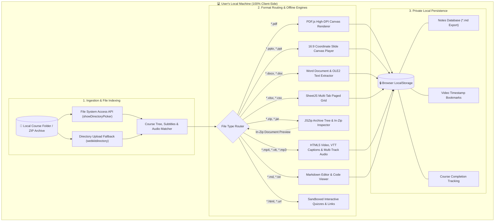
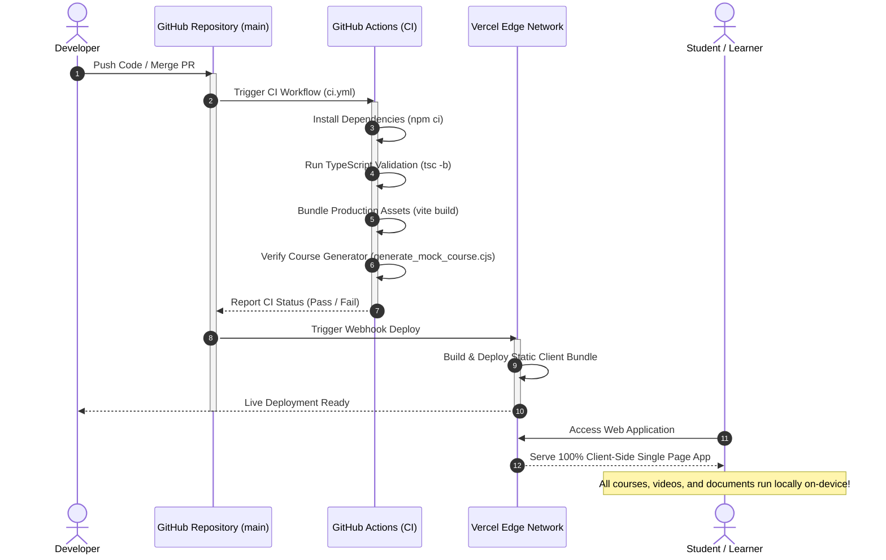

# 🪐 Akhil Orbit Player

[](https://teachable-azure.vercel.app/)
[](https://github.com/Akhil-Binu/teachable/releases)
[](https://github.com/Akhil-Binu/teachable/actions)
[](https://www.typescriptlang.org/)
[](https://react.dev/)
[](https://vite.dev/)
[](https://opensource.org/licenses/MIT)

**Akhil Orbit Player** is an ultra-fast, modern, 100% private client-side course player and document workstation designed to organize, play, and inspect educational courses and documents directly from local device folders or compressed archives.

All media rendering, document parsing, archive decompression, note taking, and progress tracking execute **entirely inside your browser**—**zero files are uploaded to any external server.**

🌐 **Live Web Application**: [https://teachable-azure.vercel.app/](https://teachable-azure.vercel.app/)

---

## 🔄 System Architecture & Application Workflow



---

## 🔄 CI / CD & Deployment Workflow



---

## 🌟 Supported Document & Media Formats

| Category | File Extensions | Capabilities & Features |
| :--- | :--- | :--- |
| **PDF Documents** | `.pdf` | High-DPI native canvas rendering via PDF.js. Single page & continuous scroll modes, zoom (50%–200%), page jumper, and 90° page rotation. |
| **PowerPoint Presentations** | `.pptx`, `.ppt`, `.ppsx`, `.odp` | 16:9 coordinate-based canvas layout with text runs, shapes, tables, embedded slide media, thumbnail outline strip, and full-screen **Present** mode. |
| **Word Documents** | `.docx`, `.doc`, `.dotx`, `.odt`, `.rtf` | High-fidelity rendering with heading styles, bullet points, font sizing, zoom controls, and **Light / Dark Paper** theme toggles. |
| **Excel & Spreadsheets** | `.xlsx`, `.xls`, `.csv`, `.tsv`, `.ods` | Multi-sheet tab workbook browser with sticky row numbers, column letters (`A`, `B`, `C`...), search filtering, 100-row pagination, and CSV export. |
| **Compressed Archives** | `.zip`, `.jar`, `.tar`, `.gz` | In-browser file tree browser, search, single-file extraction, and **embedded in-zip document viewing** without unzipping to disk! |
| **Encrypted Courses** | `.orbit` | **AES-256-GCM** authenticated encrypted course container. Protected against VLC, media players, and 7-Zip/WinRAR; only playable in Orbit Player with in-memory streaming! |
| **Video & Audio** | `.mp4`, `.webm`, `.ogg`, `.mp3`, `.wav` | HTML5 video/audio player with 0.5x–3.0x playback rates, multi-track audio switching (native & companion audio files), audio sync delay adjustment, dynamic `.vtt` caption matching, timestamp bookmarks, and auto-resume tracking. |
| **Notes & Code** | `.md`, `.txt`, `.js`, `.ts`, `.py`, `.json` | Markdown editor with local storage autosave and `.md` export. Syntax-highlighted code viewer with instant copy. |
| **Web Quizzes & Shortcuts** | `.html`, `.url` | Sandboxed interactive quiz runtime with form submission, score calculation, and Windows `.url` shortcut web portal. |

---

## 🚀 Key Feature Highlights

### 1. 📂 True Local Folder Loading
* Leverages the modern **File System Access API** (`showDirectoryPicker`) for on-demand chunk streaming directly from local disk folders.
* Includes universal **Directory Upload Fallback** (`webkitdirectory`) for complete cross-browser compatibility across Chrome, Edge, Firefox, Safari, and mobile browsers.

### 2. 🗄️ In-Zip Document & Code Inspector
* Inspect the contents of any `.zip` archive without extracting it to disk first.
* **Embedded In-Zip Viewing**: Directly view Word documents (`.docx`), PowerPoint decks (`.pptx`), Excel spreadsheets (`.xlsx`), CSV tables, and PDFs located inside compressed ZIP archives!

### 3. 🎬 Video Player, Embedded Container Audio (VLC Parity) & Multi-Track Switching
* **Embedded Container Audio Detection (VLC Parity)**: Standard web browsers (Chrome, Edge, Firefox) disable `HTMLMediaElement.audioTracks` by default, hiding internal audio streams visible in VLC. Akhil Orbit Player inspects MP4/MOV atoms (`moov` -> `trak` -> `mdhd` / `stsd`) and Matroska EBML headers (`0x1654AE6B`) directly in-browser to detect all embedded streams, track titles, codecs (AAC, AC-3, E-AC-3, Opus, FLAC), and ISO-639 languages.
* **Client-Side Demuxing & AAC Extraction**: In browsers without native multi-track flags enabled, Orbit Player extracts raw AAC sample chunks from MP4 containers, wraps them with 7-byte ADTS headers in real time, and synchronizes playback in lockstep with the primary video element.
* **Companion & Custom Audio Tracks**: Automatically pairs companion language audio files from the course folder (e.g. `lesson.es.mp3`, `lesson.dub.aac`) and supports loading custom local audio tracks on the fly.
* **Audio Delay / Sync Control**: Fine-tune audio-video synchronization with +/- 0.1s delay controls and quick cycling via the `A` keyboard shortcut.
* **Dynamic Caption Matching**: Automatically matches `.vtt` subtitles to video files with corresponding base names.
* Standalone `.vtt` files are dynamically compiled into formatted, dark-themed HTML transcript pages.
* Timestamp bookmarks allow users to tag specific video moments and jump to them in one click.

### 4. 🔒 Encrypted Course Containers (`.orbit`)
* **Proprietary Encrypted Packaging**: Package an entire multi-GB course folder (videos, multi-language audio tracks, PDFs, Word documents, slide decks, spreadsheets, and notes) into a single, clean `.orbit` container file.
* **VLC, Media Player & Extractor Immunity**: Uses military-grade **AES-256-GCM** encryption with **PBKDF2** (100,000 iterations). VLC, Windows Media Player, QuickTime, 7-Zip, and WinRAR cannot read or extract the file.
* **In-Memory Streaming (Zero Disk Leakage)**: Decryption takes place strictly inside browser RAM using `crypto.subtle`. Decrypted media streams and documents are never written to the user's hard drive.
* **One-Click Export**: Click the **"Export .orbit"** button in the sidebar header to generate and download an encrypted `.orbit` package.
* **Instant Drag-and-Drop Playback**: Drop any `.orbit` file onto the Orbit Player landing screen or click **"Open Encrypted Course (.orbit)"** to decrypt and begin studying immediately.

### 5. 📓 Markdown Notes & Knowledge Base
* Built-in Markdown notes editor autosaved in `localStorage` for every individual lesson.
* Export notes anytime as `.md` documents for offline study.

### 6. 🔒 100% Client-Side Privacy Guarantee
* **Zero Network Uploads**: Your local files, personal notes, and bookmarks never leave your device.
* **Instant Seeking**: Media and documents load at local disk bus speeds without bandwidth buffering.

---

## 🛠️ Technology Stack

* **Frontend Framework**: [React 19](https://react.dev/) with [TypeScript](https://www.typescriptlang.org/)
* **Build System**: [Vite 8](https://vite.dev/)
* **Document Engines**:
  * **PDF.js** (`pdfjs-dist`): Canvas-rendered vector PDF engine with local bundled worker.
  * **JSZip**: Archive extraction and OOXML slide/document parsing.
  * **SheetJS** (`xlsx`): Excel and tabular data workbook parser.
  * **docx-preview**: Microsoft Word OOXML styling engine.
* **Iconography**: [Lucide React](https://lucide.dev/)
* **Design System**: Pure Vanilla CSS featuring an obsidian dark theme, neon gradients, thin custom scrollbars, and responsive glassmorphism.

---

## 💻 Local Development Setup

### 1. Prerequisites
Ensure you have [Node.js](https://nodejs.org/) installed (v18 or higher recommended).

### 2. Installation
```bash
# Clone the repository
git clone https://github.com/Akhil-Binu/teachable.git

# Navigate into the project folder
cd teachable

# Install dependencies
npm install
```

### 3. Start Development Server
```bash
npm run dev
```
Open **[http://localhost:5173/](http://localhost:5173/)** in your browser.

### 4. Generate Mock Offline Course Outline
Generate a sample multi-topic course outline with PDF, Word, PowerPoint, Excel, CSV, ZIP, HTML quiz, and video files:
```bash
node generate_mock_course.cjs
```
Open the web app, click **Select Course Folder** (or **Upload Directory Fallback**), and select the generated `mock_course/` folder to explore!

### 5. Generate Encrypted Test Package (.orbit)
Generate an AES-256-GCM encrypted `.orbit` course package from `mock_course` to test in-memory decryption and container playback:
```bash
node generate_mock_orbit_course.cjs
```
Drag and drop `mock_course.orbit` directly onto Orbit Player to test instant decryption!

### 6. Standalone Desktop Packager (`OrbitPackager.exe`)
For packaging large real-world courses (10 GB, 50 GB, 100 GB+) without memory constraints, use the standalone Windows executable:
* **Download**: [OrbitPackager-Windows-x64.zip](https://github.com/Akhil-Binu/teachable/releases/latest/download/OrbitPackager-Windows-x64.zip) from [GitHub Releases](https://github.com/Akhil-Binu/teachable/releases/tag/v1.2.0).
* **Usage**:
  * **Drag & Drop**: Simply drag and drop any course folder onto `OrbitPackager.exe`.
  * **GUI Folder Picker**: Double-click `OrbitPackager.exe` to open the Windows folder picker dialog.
  * **Command Line**:
    ```bash
    .\OrbitPackager.exe "D:\My Courses\Full Stack BootCamp" "D:\My Courses\Bootcamp.orbit"
    ```
* **V2 Streaming Engine**: Streams files in 4 MB buffer chunks directly through AES-256-GCM ciphers with zero OpenSSL buffer limits. The web app decrypts the footer manifest in `< 0.1s` and decrypts lessons on-demand in browser RAM only when played.

### 7. Build for Production
```bash
npm run build
```

To build `OrbitPackager.exe` from source:
```bash
npm run build:exe
```

---

## 🤝 How to Contribute (Detailed Guide & Commands)

We welcome contributions from the community! Whether you are fixing a defect, improving document rendering, or adding support for new container codecs, follow these step-by-step commands to get started:

### Step 1: Fork and Clone the Repository
1. Click the **Fork** button at the top-right of [https://github.com/Akhil-Binu/teachable](https://github.com/Akhil-Binu/teachable) to create your personal copy.
2. Clone your fork locally and configure the `upstream` remote:
```bash
# Clone your personal fork
git clone https://github.com/<your-username>/teachable.git
cd teachable

# Add upstream repository to stay in sync with latest releases
git remote add upstream https://github.com/Akhil-Binu/teachable.git
git fetch upstream
```

### Step 2: Install Project Dependencies
Verify that you are using Node.js version 18 or higher:
```bash
# Check Node and npm versions
node -v   # Should output v18.0.0 or higher
npm -v

# Install exact dependencies
npm install
```

### Step 3: Create a Dedicated Feature Branch
Always develop inside a dedicated topic branch rather than `main`:
```bash
# Ensure your local main is up to date
git checkout main
git pull upstream main

# Create and switch to a descriptive feature or bugfix branch
git checkout -b feat/your-feature-name
# Or for bug fixes:
git checkout -b fix/issue-description
```

### Step 4: Run the Development Server
```bash
npm run dev
```
Open **[http://localhost:5173/](http://localhost:5173/)** in your browser. Vite provides instant Hot Module Replacement (HMR) as you edit files in `src/`.

### Step 5: Generate Test Media & Encrypted Courses
Use the built-in generator scripts to populate synthetic test courses:
```bash
# Generate full mock course with multi-track audio, videos, PDFs, docx, pptx, xlsx, zip:
node generate_mock_course.cjs

# Generate encrypted .orbit container to test decryption & memory streaming:
node generate_mock_orbit_course.cjs
```

### Step 6: Code Quality, Linting & Type-Checking
Before committing, ensure your code compiles with zero TypeScript errors and passes all ESLint rules:
```bash
# Run ESLint to verify syntax and React hooks rules
npm run lint

# Type-check TypeScript codebase without outputting files
npx tsc --noEmit

# Full production build verification (TypeScript compile + Vite production bundling)
npm run build

# Preview the production build locally
npm run preview
```

### Step 7: Commit Your Changes
Follow [Conventional Commits](https://www.conventionalcommits.org/) format with clear, imperative messages:
```bash
# Stage your modified files
git add src/components/YourComponent.tsx

# Commit with a structured prefix
git commit -m "feat: add support for custom subtitle font scaling"
# Other prefixes: fix:, docs:, style:, refactor:, perf:, test:, chore:
```

### Step 8: Push and Open a Pull Request
```bash
# Push your branch to your GitHub fork
git push origin feat/your-feature-name
```
Then navigate to [https://github.com/Akhil-Binu/teachable](https://github.com/Akhil-Binu/teachable) in your browser:
1. Click **Compare & pull request**.
2. Complete the pull request description detailing your changes, reproduction steps, and testing evidence.
3. Verify that the automated GitHub Actions CI pipeline passes all build checks.

For more details on our architectural conventions, see [CONTRIBUTING.md](CONTRIBUTING.md) and our [Code of Conduct](CODE_OF_CONDUCT.md).

---

## ⌨️ Video Player Keyboard Shortcuts

| Shortcut | Action | Description |
| :--- | :--- | :--- |
| <kbd>[</kbd> | **Toggle Course Sidebar** | Expand or collapse left course navigation tree |
| <kbd>]</kbd> | **Toggle Notes & Bookmarks** | Expand or collapse right Notes & Bookmarks panel to maximize viewer width |
| <kbd>Space</kbd> / <kbd>K</kbd> | **Play / Pause** | Toggle video playback |
| <kbd>J</kbd> / <kbd>L</kbd> | **Seek ±10s** | Jump backward or forward by 10 seconds |
| <kbd>←</kbd> / <kbd>→</kbd> | **Seek ±5s** | Step backward or forward by 5 seconds |
| <kbd>A</kbd> | **Cycle Audio Track** | Switch between default audio, companion language tracks, and custom files |
| <kbd>C</kbd> | **Toggle Captions** | Toggle `.vtt` closed captions on/off |
| <kbd>M</kbd> | **Mute / Unmute** | Toggle audio volume mute |
| <kbd>F</kbd> | **Fullscreen** | Enter or exit immersive full-screen mode |
| <kbd>R</kbd> | **Replay** | Restart video from timestamp 00:00 |

---

## 📄 License
This project is open-source and licensed under the [MIT License](LICENSE).
